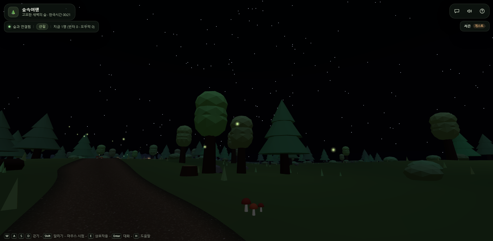
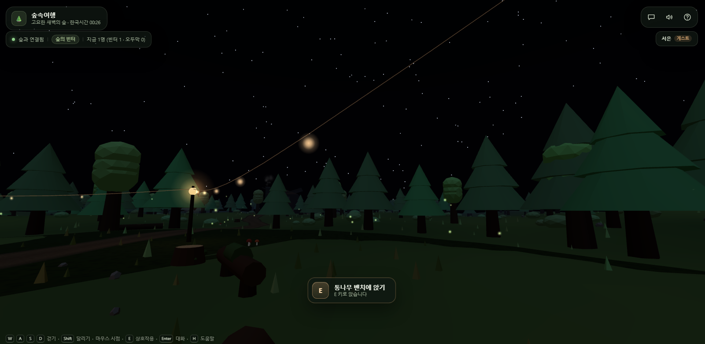
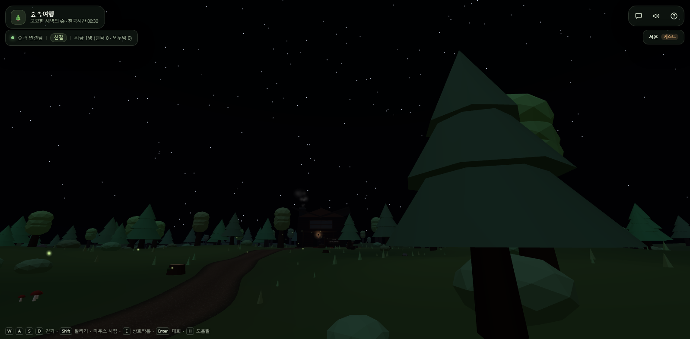
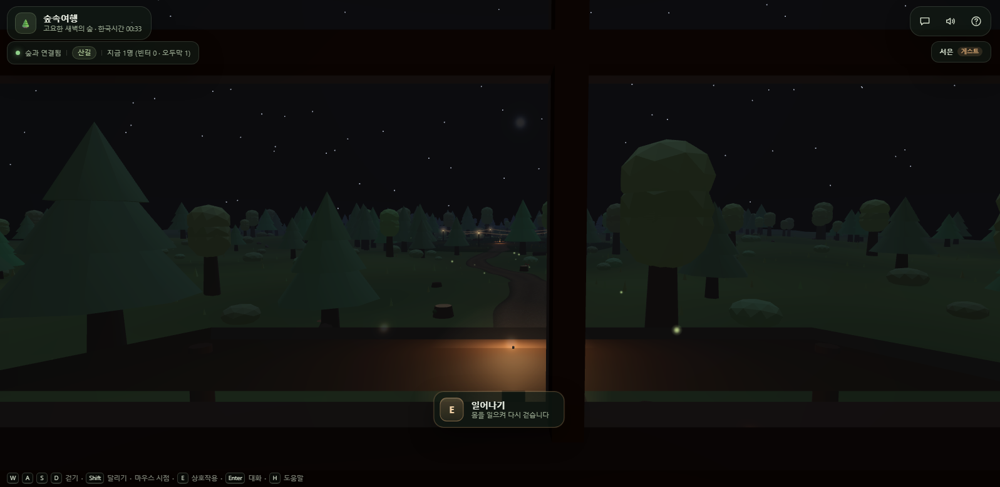
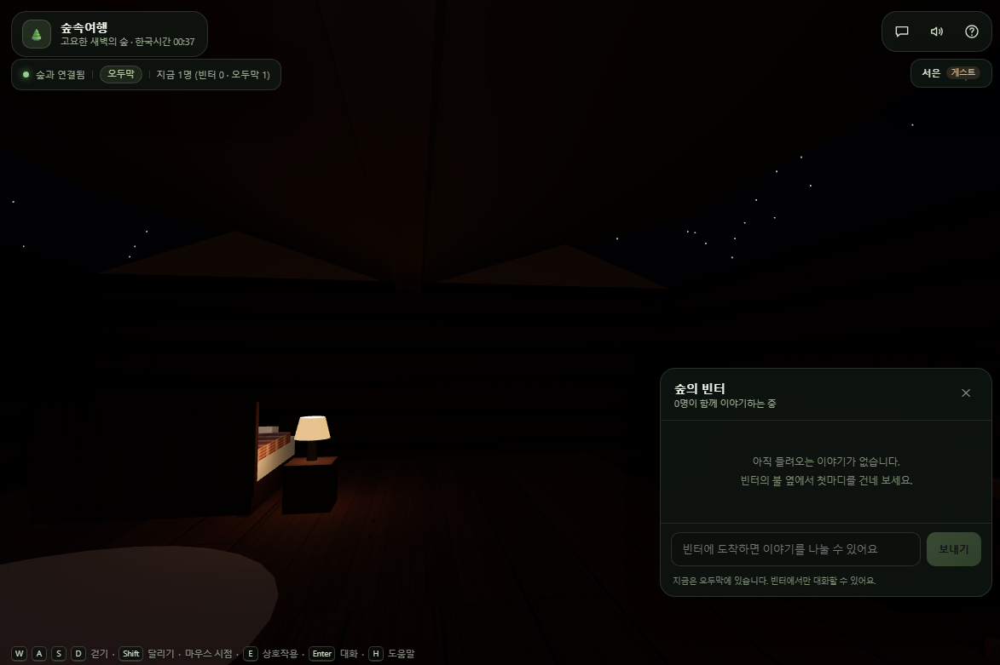
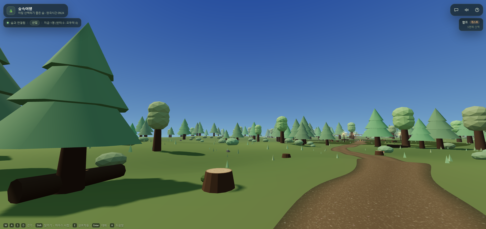
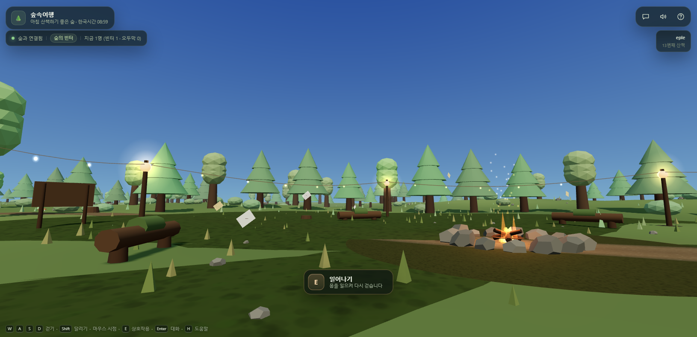
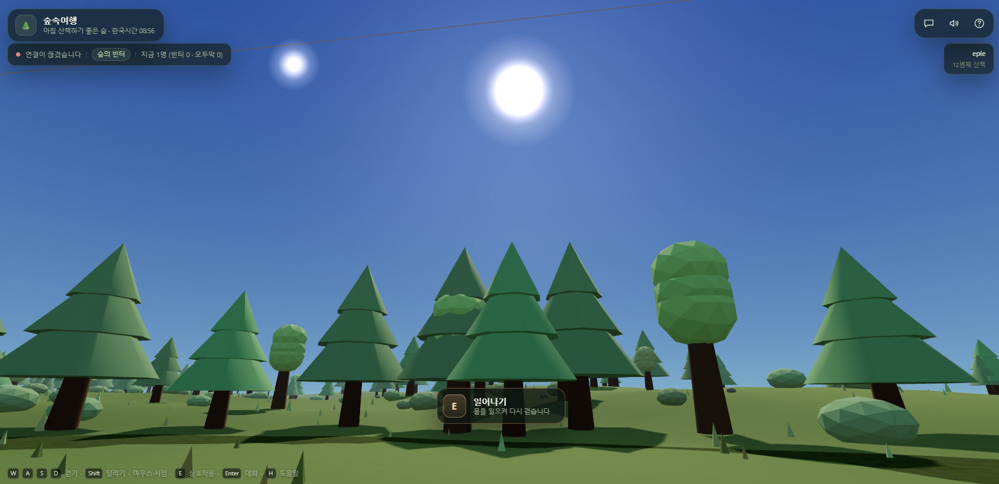
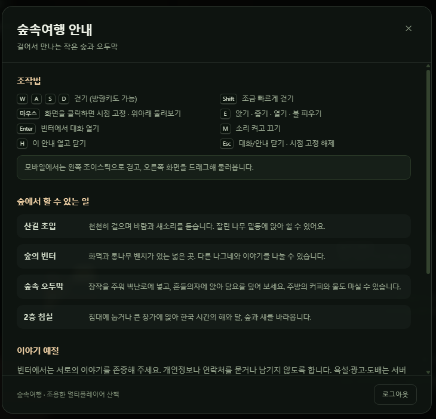

# 🌲 숲속여행 (Healing Forest Trip)

여러 사람이 같은 숲에 들어와 조용히 걷고, 빈터의 모닥불 곁에서 짧은 이야기를 나누고, 2층 오두막의 벽난로 곁에서 쉬어 가는 **1인칭 멀티플레이어 힐링 웹 앱**입니다.
"바이브 코딩으로 웹 서비스 개발하기" 과정의 **메인 퀘스트 01 - 내 서비스 만들기** 과제로 만들었습니다.

👉 **https://healing-forest-trip.onrender.com/**

> 무료 서버라 한동안 아무도 없으면 잠들어요. 첫 접속은 30초~1분쯤 걸릴 수 있어요.
> 숲은 **한국 시간**을 따라 낮과 밤이 바뀝니다. 아래 1~4는 밤에, 5는 아침에 찍었어요.

<p align="center">
  
</p>

## 시연 영상

https://github.com/user-attachments/assets/7c0b9c47-069e-4bc1-87f4-cda6547206bb

## 화면 미리보기

### 1. 숲으로 들어가기

| 첫 화면 | 나의 모습 고르기 | 출발 |
| --- | --- | --- |
|  |  |  |

처음 방문하면 여행자를 고릅니다. 남자 둘, 여자 둘, 강아지, 고양이 중 하나를 고르면 다른 나그네에게도 그 모습으로 보여요.

### 2. 산길

| 산길 초입, 입구 알림판 | 버섯이 핀 산길 |
| --- | --- |
|  |  |

### 3. 숲의 빈터

| 불빛이 이어진 빈터 | 빈터 표지판 "쉬어가는 곳" | 통나무 벤치에 앉기 |
| --- | --- | --- |
|  |  |  |

빈터에서만 대화가 열립니다. 같은 시간 숲에 있는 사람들과 짧은 이야기를 나눠 보세요.

### 4. 숲속 오두막

| 오솔길 끝의 오두막 | 오두막 앞 | 2층 큰 창가에 앉아 | 2층 침실 |
| --- | --- | --- | --- |
|  |  |  |  |

### 5. 아침의 숲 (한국 시간 오전 9시 무렵)

| 아침 산길 | 아침의 빈터 | 벤치에 앉아 올려다본 하늘 |
| --- | --- | --- |
|  |  |  |

같은 숲이 시간에 따라 바뀝니다. 밤에는 별과 반딧불이가, 아침에는 해와 나무 그림자가 숲을 채워요.

## 숲을 걷는 법

> 💡 **처음 들어가면 화면을 클릭하세요.** 눈앞의 오솔길을 따라 빈터와 오두막이 이어집니다.

**여정:** 산길 초입 → 숲의 빈터 → 오솔길 → 숲속 오두막(2층)

| 키 | 하는 일 |
| --- | --- |
| `W` `A` `S` `D` (방향키) | 걷기 |
| `Shift` | 달리기 |
| 마우스 | 화면을 클릭하면 시점 고정, 둘러보기 |
| `E` | 앉기 · 줍기 · 열기 · 불 피우기 |
| `Enter` | 빈터에서 대화 열기 |
| `M` | 소리 켜고 끄기 |
| `H` | 안내 열고 닫기 |
| `Esc` | 대화·안내 닫기, 시점 고정 풀기 |

모바일에서는 왼쪽 조이스틱으로 걷고, 오른쪽 화면을 드래그해 둘러봅니다.

<details>
<summary>게임 안 안내 화면 보기</summary>



</details>

## 주요 기능

- 🚶 **1인칭 산책**: 산길 초입 → 숲의 빈터 → 오솔길 → 숲속 오두막으로 이어지는 하나의 길
- 🪵 **쉬어 가기**: 잘린 나무 밑동, 통나무 벤치, 흔들의자, 큰 창가, 침대에 앉거나 눕기
- 💬 **빈터에서만 열리는 대화**: 실시간 채팅, 접속자 수와 지금 있는 곳 표시
- 🔥 **함께 키우는 불**: 장작을 주워 벽난로에 넣으면 불이 커져요 (서버가 상태를 관리)
- ☕ **오두막의 작은 일들**: 흔들의자에서 무릎담요 덮기, 주방의 커피와 물 마시기
- 🌙 **한국 시간의 하늘**: 2층 큰 창으로 해, 달, 별과 반딧불이를 바라보기
- 🎧 **외부 음원 없는 숲소리**: 바람, 새소리, 발소리, 장작 소리를 브라우저에서 합성
- 🐾 **나의 모습**: 남자 둘, 여자 둘, 강아지, 고양이 중 고르기
- 🔐 **Google 로그인 + 게스트 입장**: 이메일은 저장하지 않아요
- 👋 **창을 닫으면 바로 퇴장**: 접속자 목록에서 즉시 빠짐

## 과제 제출물

| 제출물 | 위치 |
| --- | --- |
| 실행 가능한 웹 서비스 | https://healing-forest-trip.onrender.com/ |
| 기획 문서 | [PRD.md](PRD.md) |
| 회고록 | [retrospective.md](retrospective.md) |
| 시연 영상 | [위 시연 영상](#시연-영상) (원본 파일: [docs/video](docs/video/healing-forest-trip-video.mp4)) |
| AI와 나눈 대화 요약 | [docs/conversation-summary.md](docs/conversation-summary.md) (⭐ 가장 효과적이었던 프롬프트 포함) |

## 빠른 시작

```bash
# Node.js 24 이상
npm install

copy .env.example .env.local   # Windows
# cp .env.example .env.local  # macOS/Linux

npm run dev
# → http://localhost:3000
```

`.env.local` 에 `NEXTAUTH_SECRET`(32자 이상)만 채우면 게스트 로그인으로 바로 들어갈 수 있습니다.
Google 로그인을 쓰려면 `GOOGLE_CLIENT_ID` / `GOOGLE_CLIENT_SECRET` 을 추가하고,
승인된 리디렉션 URI 에 `http://localhost:3000/api/auth/callback/google` 을 등록하세요.

DB 없이도 모든 기능이 동작합니다(방문/채팅/장작 상태만 저장되지 않음).
Neon Postgres 를 연결하려면:

```bash
# .env.local 에 DATABASE_URL 추가 후
npm run db:migrate
```

<details>
<summary>스크립트</summary>

| 명령 | 설명 |
| --- | --- |
| `npm run dev` | 커스텀 서버(Next + Socket.IO) 개발 모드 |
| `npm run build` | Next.js 프로덕션 빌드 |
| `npm start` | 프로덕션 서버 실행 (`node server.mjs`) |
| `npm run typecheck` | TypeScript 검사 |
| `npm run lint` | ESLint |
| `npm run db:migrate` | Neon 스키마 적용 (멱등) |
| `npm run db:prune` | 30일 채팅 / 90일 방문 / 180일 감사 로그 정리 |
| `node scripts/smoke-visual.mjs` | 랜딩~오두막 고급 회귀(스크린샷, 콘솔 오류 수집) |
| `node scripts/smoke-two.mjs` | 2탭 멀티플레이 회귀(동기화·즉시 퇴장 확인) |

</details>

<details>
<summary>기술 스택</summary>

- **Next.js 14.2** (App Router) · React 18.3 · TypeScript 5.6
- **React Three Fiber 8.17** · drei 9.114 · three 0.169 — 에셋 없이 절차 생성한 숲/오두막
- **Socket.IO 4.8** — 커스텀 서버(`server.mjs`)에서 Next 와 함께 운영
- **NextAuth 4.24** — Google OAuth + 게스트 Credentials, JWT 세션
- **Zustand 4.5** — HUD/게임 상태
- **Neon Postgres + pg 8.13** — 선택적 영속화, 파라미터 바인딩만 사용

</details>

<details>
<summary>프로젝트 구조</summary>

```
healing-forest-trip/
├─ server.mjs                 # Next + Socket.IO + /healthz + /api/stats
├─ server/
│  ├─ security.mjs            # 입력 정화·토큰 버킷·오리진 검증
│  └─ db.mjs                  # Neon 풀/쿼리/정리
├─ db/schema.sql              # users, visits, chat_messages, world_state, audit_events
├─ shared/world.json          # 클라·서버 공용 좌표/리밋
├─ scripts/migrate.mjs        # 스키마 적용
├─ scripts/prune.mjs          # 보관 기간 정리
├─ src/
│  ├─ app/                    # 랜딩(/) · 숲(/forest) · NextAuth 라우트 · globals.css
│  ├─ middleware.ts           # nonce CSP + 보안 헤더
│  ├─ lib/
│  │  ├─ world.ts             # 지형·충돌·좌표·존의 단일 기준
│  │  ├─ auth.ts              # Google/게스트, 닉네임 정화, 리다이렉트 검증
│  │  ├─ audio.ts             # 절차적 사운드 엔진
│  │  ├─ textures.ts          # 절차적 텍스처
│  │  ├─ time.ts              # 한국 시간 · 태양/달 상태
│  │  ├─ input.ts             # 키/터치 입력 버스
│  │  └─ socket.ts            # 세션 쿠키 기반 소켓
│  ├─ components/forest/      # Sky, Terrain, Forest, Stumps, Clearing, Cabin, Player …
│  ├─ components/ui/          # HUD, Chat, Help, Start, Rest, Toast, MobileControls
│  └─ store/game.ts           # 게임 상태 · useClock
└─ docs/                      # 설계/보안/운영/배포 문서, images/ 화면 캡처
```

</details>

## 문서

설계부터 보안 점검까지 `docs/`에 20개 문서로 남겨 두었습니다.

| 분류 | 문서 |
| --- | --- |
| 기획 | [PRD](PRD.md) · [서비스 개요와 여정](docs/01-overview.md) · [공간·상호작용](docs/02-experience.md) · [조작법과 접근성](docs/03-controls.md) |
| 설계 | [시스템 구조](docs/04-architecture.md) · [실시간 프로토콜](docs/05-multiplayer.md) · [월드 좌표/지형/충돌](docs/06-world.md) · [절차적 사운드](docs/07-audio.md) |
| 보안·개인정보 | [보안 모델](docs/08-security.md) · [데이터·프라이버시](docs/09-privacy.md) · [시큐리티 테스트 계획](docs/17-security-test-plan.md) · [보안 결과 보고](docs/19-security-report.md) |
| 운영·배포 | [운영/모니터링](docs/10-operations.md) · [성능](docs/11-performance.md) · [Render + Neon 배포](docs/12-deployment.md) · [문제 해결](docs/14-troubleshooting.md) |
| 테스트 | [검증 체크리스트](docs/13-testing.md) · [테스트 계획](docs/16-test-plan.md) · [테스트 결과 보고](docs/18-test-report.md) |
| 기타 | [기여 규칙](docs/15-contributing.md) · [대화 요약](docs/conversation-summary.md) |

## 보안 요약

- nonce 기반 CSP, HSTS, `X-Frame-Options: DENY`, `frame-ancestors 'none'`
- 소켓 핸드셰이크에서 서버가 NextAuth JWT 를 직접 검증 (클라이언트 이름 불신)
- Origin 검증, IP별 연결 수/시도 제한, 전체 40명 정원, 16KB 소켓 payload 제한
- 세션 토큰 쿠키는 브라우저 세션 쿠키로 발급, 탭 종료 시 소켓 즉시 종료
- 채팅은 서버가 빈터 존을 확인하고 240자·1.5초 쿨다운·중복/도배 제한
- 모든 SQL 파라미터 바인딩, 이메일 미수집, IP 원문 미저장(로그 상관용 해시만)
- 오픈 리다이렉트 방지, 운영 환경 변수 검증(32자 시크릿/HTTPS URL)

자세한 내용은 [docs/08-security.md](docs/08-security.md), 배포 절차는
[docs/12-deployment.md](docs/12-deployment.md)를 참고하세요.

## 만든 과정

1. **기획:** "말이 없어도 함께 있는 느낌"이라는 한 줄에서 시작해 [PRD](PRD.md)로 범위를 정했습니다. 경쟁과 보상 없이, 설치 없이 브라우저에서 바로 들어오는 숲입니다.
2. **구현:** AI 코딩 도구 오픈코드(opencode)와 대화하며 숲, 빈터, 오두막, 실시간 접속, 소리를 차례로 만들었습니다. 핵심 결정은 [대화 요약](docs/conversation-summary.md)에 남겼습니다.
3. **점검과 배포:** 보안·성능 점검 문서를 쓰고, Render에 배포했습니다. 마지막 배포 설정과 Node 버전 정리는 Claude Code가 도왔습니다.
4. 모든 변경은 커밋으로 남겨 두었습니다: [커밋 기록](https://github.com/eple-lab/healing-forest-trip/commits/main)

## 라이선스

개인/교육용 프로젝트입니다. 외부 3D/음원 에셋을 사용하지 않고 브라우저에서 절차 생성합니다.
